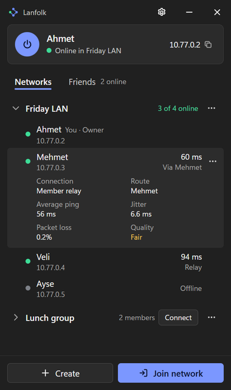
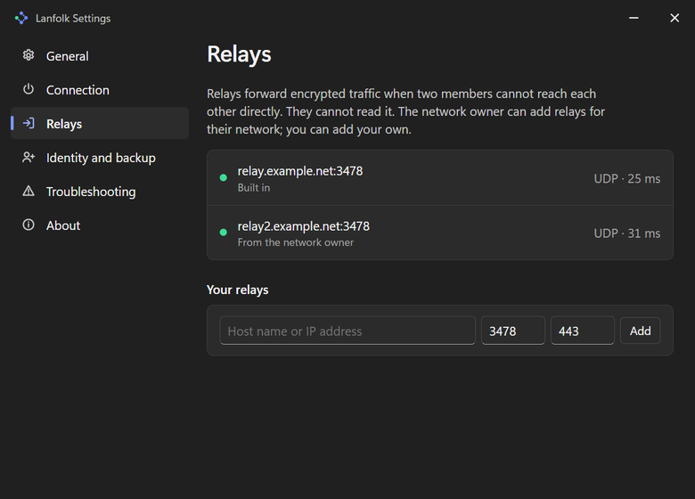

# Lanfolk

Lanfolk is an open-source virtual LAN for playing LAN games with friends over the internet. Each member of a private network gets a virtual IP address on a Windows virtual adapter, and games see each other as if they shared a local network. It works even when every player is behind CGNAT and cannot open ports.

Lanfolk is not a VPN for your internet traffic: only traffic to the virtual network `10.77.0.0/24` goes through it. It does not share files or printers.

<p align="center">
  
  &nbsp;
  
</p>
<p align="center"><sub>Preview with sample data (<code>Lanfolk.exe -mock</code>).</sub></p>

## Status

**Under active development. There is no release yet.**

What exists and is covered by automated tests:

- the shared relay (`lanfolk-relay`, STUN, signaling and fallback forwarding over UDP and TCP) with its Docker deployment, running on a test server;
- the client: identity and friend codes, signed member lists, the path manager, the relay client and WireGuard bind, broadcast and multicast over the tunnel, member relaying, UPnP/NAT-PMP/PCP port mapping, the DHT fallback and connection codes, Windows adapter and firewall configuration, all tied together by the engine;
- the Windows service (`lanfolk-service`), the command line client (`lanfolk-cli`) and the desktop app (`Lanfolk.exe`);
- the measurement tools `natprobe` and `lanprobe`, and the Inno Setup installer script.

What is still open: tests that need administrator rights, two Windows machines and real ISP lines (Wintun, firewall rules, the installer on clean Windows, the line matrix and real games). See the progress notes in the [implementation plan](docs/lanfolk-open-source-virtual-LAN-implementation-plan.md), [docs/TESTING.md](docs/TESTING.md) and [docs/DECISIONS.md](docs/DECISIONS.md).

## Quick start (players)

When a release is available:

1. Download the installer from the GitHub Releases page and run it (Windows 10 or 11, 64-bit).
2. Open Lanfolk and choose a nickname.
3. One of you creates a network and sends the invite code; the others choose **Join network** and paste it.
4. Start your game and look for the others in its LAN browser.

The full guide is [docs/SETUP.md](docs/SETUP.md). If a game does not find the other players, see its troubleshooting section and [docs/COMPATIBILITY.md](docs/COMPATIBILITY.md).

## Run your own relay

Anyone can run a relay with Docker on a small server: [docs/SELF_HOST.md](docs/SELF_HOST.md).

## How it works

- **Friends** exchange friend codes, which carry their public keys. Both sides must enter the other's code.
- A **network owner** creates a private network and adds friends. The owner signs the member list. Members connect in a full mesh over WireGuard-compatible encrypted tunnels (Wintun adapter, wireguard-go).
- A **direct path** is always preferred, using UDP hole punching on a single UDP socket. If it fails, traffic goes through another member, or through the shared relay (UDP, or TCP when UDP is blocked). The relay forwards encrypted packets only; it cannot read them.
- **Broadcast and multicast** traffic, which LAN games use to find each other, is captured and carried to the other members, so no game-specific rules are needed.
- If no relay is reachable for a while, the BitTorrent DHT or a hand-shared connection code can still connect two friends.

The byte-level details are in [docs/PROTOCOL.md](docs/PROTOCOL.md).

## Repository layout

| Path | Contents |
| --- | --- |
| `cmd/lanfolk-relay` | Shared relay (STUN, signaling, fallback forwarding) |
| `cmd/natprobe` | NAT and DHT measurement tool |
| `cmd/lanprobe` | LAN behavior and tunnel latency test tool |
| `cmd/lanfolk-service`, `cmd/lanfolk-cli`, `ui` | Windows service, command line client and desktop app (Wails) |
| `internal/engine` | Client core that ties all packages together |
| `internal/store` | Local data file |
| `internal/tunwrap` | LAN layer: broadcast and multicast copying, port filter |
| `internal/clock` | High-resolution clock for latency measurements |
| `internal/discovery` | DHT records (BEP 44) and connection codes |
| `internal/identity` | Keys, friend codes and pair secrets |
| `internal/ipc` | Local control protocol between service and clients |
| `internal/lanprobe` | Implementation of `lanprobe` |
| `internal/natprobe` | Implementation of `natprobe` |
| `internal/network` | Signed member lists and virtual IPs |
| `internal/pathmgr` | Path candidates, probes, selection and quality |
| `internal/peermsg` | Encrypted peer control messages |
| `internal/portmap` | UPnP, NAT-PMP and PCP port mapping |
| `internal/relay` | Relay server |
| `internal/stun` | Minimal STUN client and server messages |
| `internal/transport` | Shared UDP socket, WireGuard bind, relay client |
| `internal/version` | Build-time version and default relay |
| `internal/winnet` | Windows adapter, metric, profile and firewall |
| `internal/wire` | Packet formats of the single UDP socket |
| `deploy/relay` | Dockerfile, compose file and `.env.example` for the relay |
| `installer` | Inno Setup installer script and wizard artwork |
| `scripts` | Release build, Wintun download and notices generator |
| `docs` | Protocol, setup, self-hosting, compatibility, testing, decisions and measurements |
| `.github/workflows` | Manual-only CI and release workflows |

## Building from source

You need Go (the version in `go.mod`). Tests with `-race` need cgo, so on Windows install a MinGW-w64 GCC.

```sh
go build ./...
go test -race ./...
```

Release build on Windows (PowerShell 5.1 or later; Inno Setup 6.7 or newer is optional and builds the installer):

```powershell
powershell -NoProfile -ExecutionPolicy Bypass -File scripts\build-release.ps1 -Version 1.0.0
```

The script builds all binaries with `-trimpath`, downloads and verifies `wintun.dll` (`scripts\fetch-wintun.ps1`), regenerates `THIRD_PARTY_NOTICES.md` (`go run ./scripts/gen-notices`), builds the installer (`installer\lanfolk.iss`) and writes `SHA256SUMS` into `dist\`. The script finds `ISCC.exe` on `PATH`, in `%USERPROFILE%\sdk\innosetup6` or in Program Files; pass `-Iscc <path>` to override. Inno Setup can be installed per user without administrator rights: `innosetup-6.x.x.exe /VERYSILENT /CURRENTUSER /NORESTART /DIR="%USERPROFILE%\sdk\innosetup6"`. When `ui\winres\winres.json` exists, the script first embeds the UI's icon and version resources with go-winres.

The default relay is not stored in the repository. Create an untracked `build.env` in the repository root with the relay you want to build in (use your own values):

```dotenv
LANFOLK_DEFAULT_RELAY_HOST=relay.example.org
LANFOLK_DEFAULT_RELAY_UDP_PORT=3478
LANFOLK_DEFAULT_RELAY_TCP_PORT=443
```

`build.env` is ignored by git. Without it the script falls back to the `ip` key of a local `.env` file, or you can pass `-NoDefaultRelay`. Users can always change the relay in Settings.

The relay image is built with Docker; see [docs/SELF_HOST.md](docs/SELF_HOST.md).

## Documentation

| Document | For |
| --- | --- |
| [docs/SETUP.md](docs/SETUP.md) | Players: install, friends, networks, troubleshooting |
| [docs/SELF_HOST.md](docs/SELF_HOST.md) | Running your own relay |
| [docs/COMPATIBILITY.md](docs/COMPATIBILITY.md) | Which LAN behaviors Lanfolk carries |
| [docs/PROTOCOL.md](docs/PROTOCOL.md) | Byte-level protocol specification |
| [docs/TESTING.md](docs/TESTING.md) | Human test procedures |
| [docs/MEASUREMENTS.md](docs/MEASUREMENTS.md) | Field measurements |
| [docs/DECISIONS.md](docs/DECISIONS.md) | Decisions and deviations from the plan |
| [implementation plan](docs/lanfolk-open-source-virtual-LAN-implementation-plan.md) | Design and progress |
| [CONTRIBUTING.md](CONTRIBUTING.md) | How to contribute |
| [SECURITY.md](SECURITY.md) | Reporting vulnerabilities |
| [CODE_OF_CONDUCT.md](CODE_OF_CONDUCT.md) | Community rules |
| [THIRD_PARTY_NOTICES.md](THIRD_PARTY_NOTICES.md) | Licenses of included components |

## License

Apache-2.0. See [LICENSE](LICENSE). Third-party components and their licenses are listed in [THIRD_PARTY_NOTICES.md](THIRD_PARTY_NOTICES.md). "WireGuard" is a registered trademark of Jason A. Donenfeld; Lanfolk is not affiliated with the WireGuard project.
